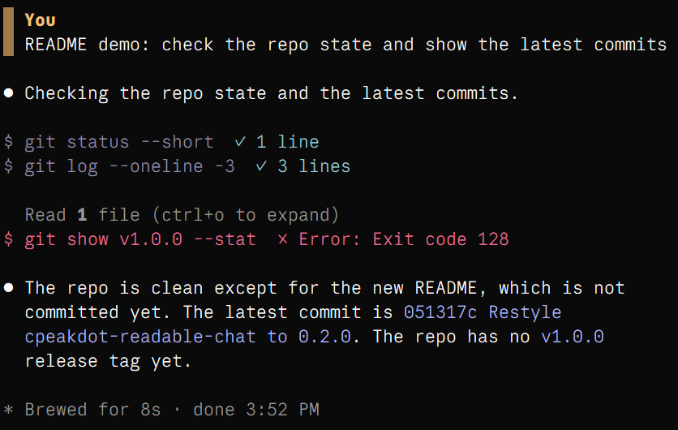

# cpeakdot-claude-mods

Mods for the [Claude Code](https://code.claude.com) CLI by cpeakdot.

This repository is a Claude Code plugin marketplace. Each mod is a plugin in the `plugins/` folder.

## Mods

### cpeakdot-readable-chat

Makes the terminal transcript easier to read. Claude's replies stand out. Your messages are easy to find when you scroll back. Tool calls fade into the background.



What it changes (terminal only):

- **Your messages** get a muted gold bar on the left and a bold gold `You` label.
- **Tool calls** become one dim line each, with a state mark:
  - `$ git status --short  ✓ 5 lines` (done)
  - `$ dotnet test  … running` (running)
  - `$ git show v1.0.0 --stat  ✗ Error: Exit code 128` (failed, in red)
  - `↳ Read LevelTimer.cs`, `✎ Edit LevelTimer.cs`, `⌕ Grep ResetTimer`
- **Shell lines** hide a leading `cd <path> &&`, so the real command shows.
- **Tool results** (output, diffs) are hidden. Press `Ctrl+O` to see the full rows.
- **Spacing:** one blank line above a run of tool calls, none inside the run.
- **Replies** stop at 100 columns on a wide terminal.

Colours come from [Rosé Pine](https://github.com/rose-pine/neovim). The bar colour `#a07c4a` is a custom muted gold.

The mod does not change the Desktop app, VS Code or the mobile apps. It does not change messages from background tasks or other agents.

## Install

Type this at the Claude Code prompt:

```
/plugin install cpeakdot-readable-chat --marketplace cpeakdot/cpeakdot-claude-mods
```

Answer `y` to add the marketplace, then pick a scope (`user` for all your projects).

Or use the shell:

```sh
claude plugin marketplace add cpeakdot/cpeakdot-claude-mods
claude plugin install cpeakdot-readable-chat@cpeakdot-claude-mods --scope user
```

Then run `/reload-plugins` in an open session, or start a new session.

## Update

```sh
claude plugin marketplace update cpeakdot-claude-mods
claude plugin update cpeakdot-readable-chat
```

## Turn off or remove

- Turn off for a while: `claude plugin disable cpeakdot-readable-chat`, or use `/plugin`.
- Remove: `claude plugin uninstall cpeakdot-readable-chat`.

## Requirements

- Claude Code with mod (function hook) support. Tested on Claude Code 2.1.332.
- A terminal with truecolor support for the exact colours.

## Develop

1. Clone the repository.
2. Add the clone as a local marketplace: `claude plugin marketplace add <path to clone>`.
3. Install the mod from it: `claude plugin install cpeakdot-readable-chat@cpeakdot-claude-mods`.
4. Edit `plugins/cpeakdot-readable-chat/hooks/register.tsx`, then run `/reload-plugins`.

Checks:

```sh
claude plugin validate plugins/cpeakdot-readable-chat
claude plugin test plugins/cpeakdot-readable-chat
```

## License

[MIT](LICENSE)
